# Kubernetes Flask Web Application Deployment

A containerized Python Flask web application deployed on a local Kubernetes cluster using Docker Desktop.

## Project Overview

This project demonstrates how to develop a Flask application, package it into a Docker image, and deploy it using Kubernetes.

## Technologies

- Python and Flask
- Docker
- Kubernetes
- kubectl
- YAML
- Git and GitHub

## Features

- Company website
- Health check endpoint (`/health`)
- Application information endpoint (`/info`)
- Kubernetes Deployments and Services
- Application scaling and self-healing
- Rolling updates and rollbacks

## Screenshots and Demonstration

The following screenshots were captured during the Kubernetes Lab 2 demonstration.

### Kubernetes Environment

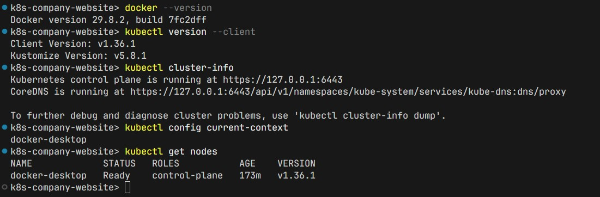

### Docker Images

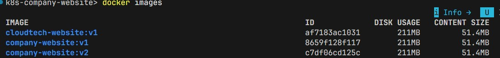

### Kubernetes Deployments

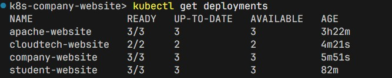

### Running Pods and Services

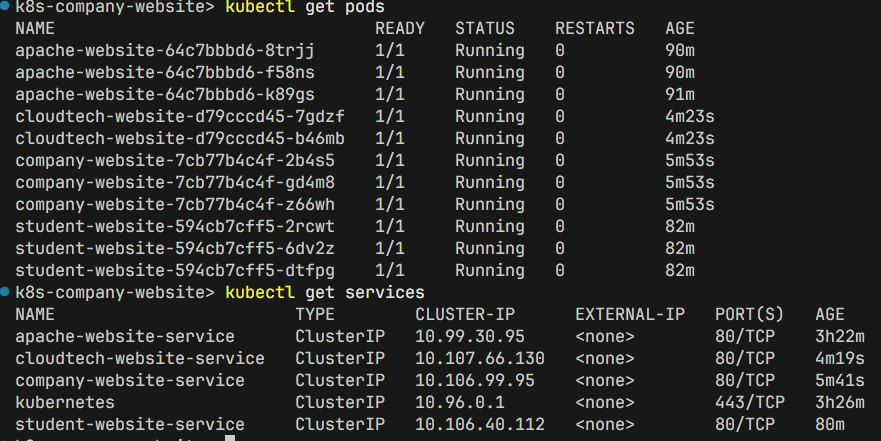

### Flask Application

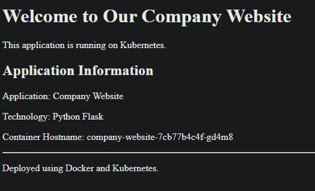

### Health Endpoint

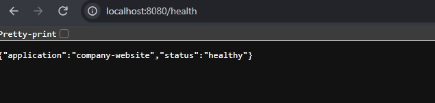

### Application Information

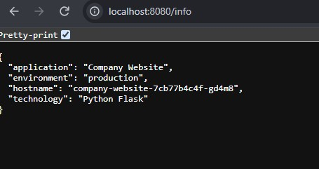

### Horizontal Scaling

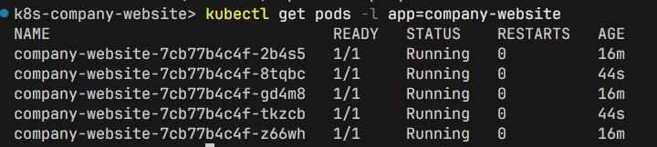

### Rolling Update

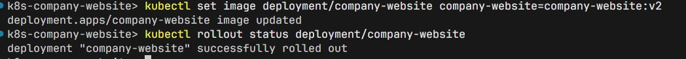

### Updated Flask Website (v2)

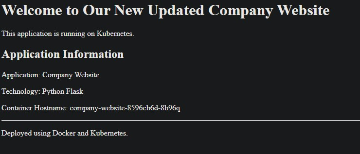

### Application Rollback

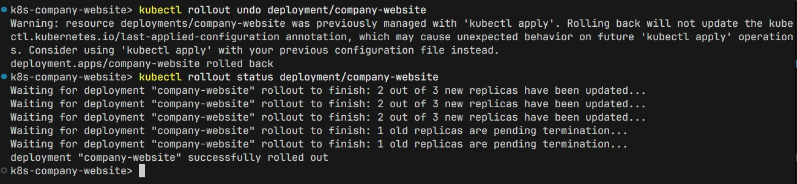

### Customized Flask Website

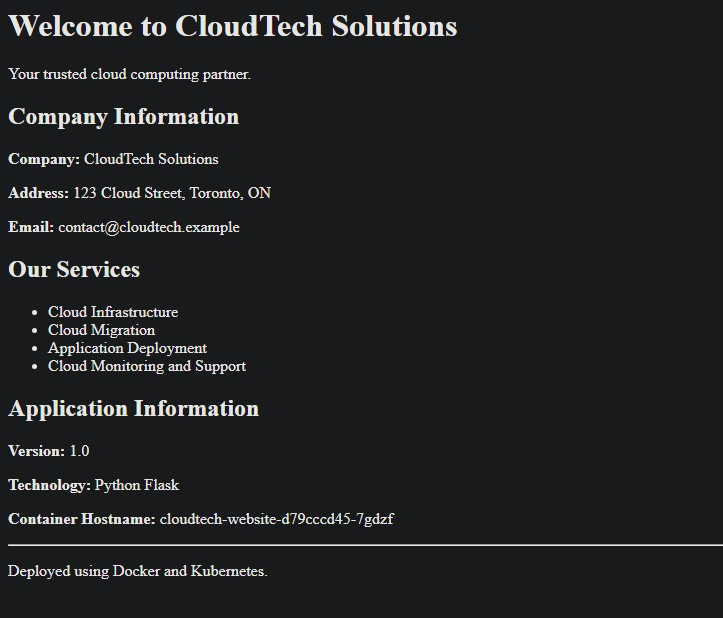

### Apache Web Server

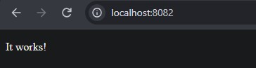

### Nginx Web Server

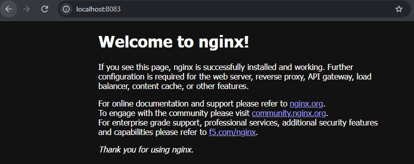

For testing commands, validation results, and troubleshooting details, see [TESTING.md](TESTING.md).

## Learning Objectives

Understand how containerized web applications are built, deployed, managed, and updated using Kubernetes.